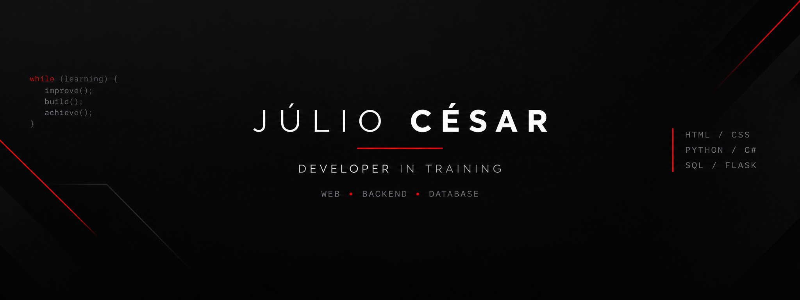

<p align="center">
  
</p>

# Olá! Eu sou o Júlio César

### Desenvolvedor em formação | Web • Backend • Banco de Dados

Sou estudante de desenvolvimento de software e gosto de transformar ideias em projetos reais.

Atualmente estou desenvolvendo minhas habilidades em **desenvolvimento web, programação, banco de dados e criação de sistemas**.

---

## Sobre mim

- Estudando desenvolvimento de software
- Desenvolvimento Web
- Python
- C#
- MySQL / SQL
- HTML & CSS
- Flask
- Git e GitHub
- Desenvolvimento de sistemas

---

## Tecnologias

### Linguagens


### Desenvolvimento


---

# Projetos principais

<table>
<tr>

<td width="50%" valign="top">

## Truck Parts

E-commerce desenvolvido para uma loja de peças para caminhões.

**Tecnologias**

`HTML` `CSS` `Flask` `Python` `MySQL`

**Principais funcionalidades**

- Cadastro e login de usuários
- Catálogo de produtos
- Pesquisa e filtros
- Carrinho de compras
- Finalização de compra
- Banco de dados MySQL
- Sistema de autenticação

<br>

<a href="https://github.com/Juliopaquit0">
  
</a>

</td>

<td width="50%" valign="top">

## Motorsport Platform

Plataforma voltada para jovens pilotos que desejam evoluir no automobilismo.

**Principais funcionalidades**

- Registro de treinos
- Acompanhamento de desempenho
- Vídeos de corridas
- Técnicas de pilotagem
- Histórico de sessões
- Evolução do piloto

<br>

<a href="https://github.com/Juliopaquit0">
  
</a>

</td>

</tr>

<tr>

<td width="50%" valign="top">

## Projetos em C#

Coleção de projetos desenvolvidos durante meus estudos de programação e lógica.

**Projetos**

- Jogo de adivinhação
- Blackjack
- Snake
- Sistemas interativos
- Exercícios de lógica

**Tecnologia**

`C#`

<br>

<a href="https://github.com/Juliopaquit0">
  
</a>

</td>

<td width="50%" valign="top">

## Projetos em Python

Projetos desenvolvidos para praticar programação, manipulação de dados e automação.

**Estudos**

- Pandas
- Manipulação de dados
- Filtros
- Agrupamentos
- Sistemas de cadastro
- Lógica de programação

**Tecnologia**

`Python`

<br>

<a href="https://github.com/Juliopaquit0">
  
</a>

</td>

</tr>
</table>

---

## Atualmente estudando

```text
Desenvolvimento Web
        ↓
     Python
        ↓
      Flask
        ↓
      MySQL
        ↓
  Desenvolvimento
     de Sistemas
